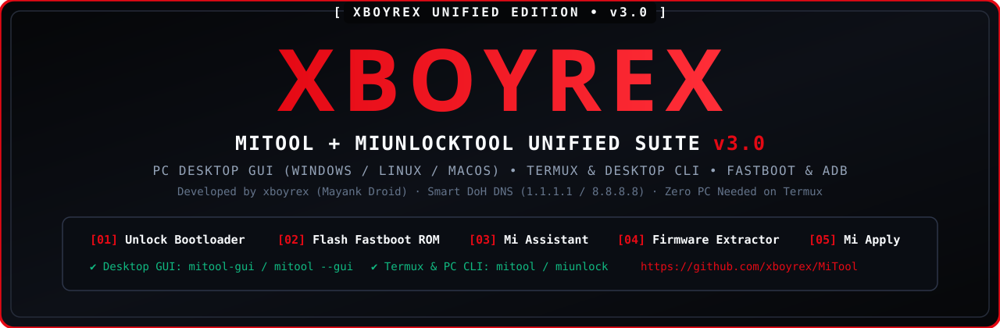

<div align="center">

  
  <br><br>

  <a href="https://github.com/xboyrex/MiTool"></a>
  <a href="https://github.com/xboyrex/MiTool/releases"></a>
  <a href="CHANGELOG.md"></a>
  <a href="./LICENSE"></a>

  <br><br>
  <b>Unlock the bootloader, flash Fastboot & Recovery ROMs, extract firmware Over-The-Air, and apply HyperOS unlock permissions (works on Android via Termux AND on Windows, Linux, and macOS via CLI & Desktop GUI).</b>

</div>

___

### 1. Android (Termux) Quick Installation — Copy & Paste

On Termux (without root), ensure the [Termux:API](https://github.com/termux/termux-api/releases/latest) app is installed and run:

```sh
curl -sS https://raw.githubusercontent.com/xboyrex/MiTool/main/install.sh | bash
```

Then run:

```sh
mitool
# Or launch the standalone unlocker directly:
miunlock
```

___

### 2. Windows / Linux / macOS Installation (CLI + Desktop GUI)

#### Install from GitHub or Local Folder:

```bash
pip install -U git+https://github.com/xboyrex/MiTool.git
```

#### Launch Terminal CLI (`[01]`–`[05]`):

```bash
mitool
```

#### Launch PC Desktop GUI Window:

```bash
mitool-gui
# Or:
mitool --gui
# Or double-click `run_pc_gui.bat` on Windows!
```

#### Build Standalone Windows `.exe` (`MiTool_by_xboyrex_v3.0.exe`):

Double-click `build_pc_exe.bat` on Windows.

___

<a id="how-it-works"></a>
### 3. Execution Pipeline & Integrated Features

| Stage | Tool / Command | Description |
| :---: | :--- | :--- |
| **`[01]`** | **Unlock Bootloader (`miunlock`)** | Integrated `MiUnlockTool` engine — Xiaomi Account login, regional `dataCenterZone` routing, Fastboot `deviceToken` & `encryptData` unlocking |
| **`[02]`** | **Flash Fastboot ROM.tgz (`miflash`)** | Flash official Xiaomi MIUI & HyperOS `.tgz` Fastboot ROMs |
| **`[03]`** | **Mi Assistant (`miasst`)** | Read info, check MD5, sideload official Recovery ROMs & format data without unlocking |
| **`[04]`** | **Firmware Content Extractor (`fcetool`)** | Extract `boot.img` / `init_boot.img` directly from remote ROM `.zip` URLs without full download |
| **`[05]`** | **Apply Unlock Permission (`miapply`)** | Automated `00:00` Beijing Time (`GMT+8`) HyperOS Xiaomi Community unlock quota submission |
| **`[G ]`** | **Desktop GUI (`mitool-gui`)** | Full Windows / Linux / macOS GUI with Live Execution Console, Fastboot/ADB Inspector & Error Code Resolver |

___

### 4. Documentation & Reference Guides

- 📖 **[Installation Guide (Windows, Linux, macOS, Termux)](INSTALL.md)**
- ❓ **[FAQ & Legacy No-Wipe Devices](FAQ.md)**
- 🔑 **[Xiaomi Unlock Error Codes Reference (`10000`–`30002`)](miunlock-codes-reference.md)**
- 🔐 **[How `encryptData` & `deviceToken` Work](encryptData.md)**
- 🛡️ **[Step-by-Step Bootloader Unlock Guide](unlock_guide.md)**

___

<div align="center">

  **Developed by [xboyrex (Mayank Droid)](https://github.com/xboyrex)**  
  [Website](https://xboyrex.github.io/mayank-droid/) • [Telegram](https://t.me/MayankDroid7) • [YouTube (@mayankdroid)](https://youtube.com/@mayankdroid) • [YouTube (@onyxdroid89)](https://youtube.com/@onyxdroid89)

</div>
