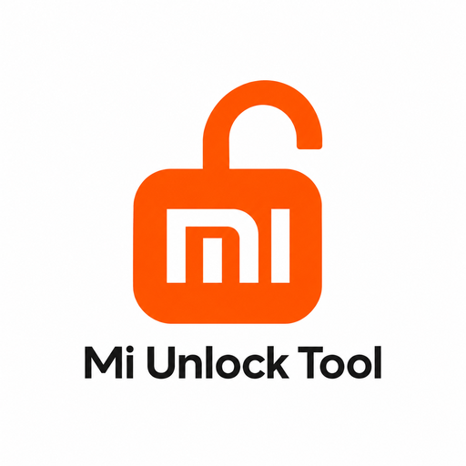

<div align="center">

# Mi Unlock Tool



<br/>

**A next-generation Xiaomi HyperOS & MIUI Bootloader Unlock Suite for Android with a pure AMOLED Dark + Onyx Yellow (`#FFD600`) Liquid Glass UI, Beijing Midnight Quota Sniper, USB OTG Fastboot Controller, and `encryptData(token)` Generator.**

[](https://github.com/xboyrex/miunlocktool/releases/latest)
[-3DDC84?style=flat-square&logo=android&logoColor=white)](https://github.com/xboyrex/miunlocktool/releases/latest)
[](https://github.com/xboyrex/miunlocktool)
[](LICENSE)

<br/>

[**⬇️ Download Latest APK (v8.5.0)**](https://github.com/xboyrex/miunlocktool/releases/latest) &nbsp;•&nbsp; [**💬 Join Telegram (@MayankDroid7)**](https://t.me/MayankDroid7) &nbsp;•&nbsp; [**⚡ Onyx Hub (@OnyxHub7)**](https://t.me/OnyxHub7)

</div>

---

## ✨ Features

- **AMOLED Dark + Onyx Yellow (`#FFD600`) Liquid Glass UI** — Frosted refractive glass shaders, velocity-reactive bottom navigation pill, 120Hz/144Hz high-refresh-rate spring physics, and YTX Rounded Heavy typography.
- **High-Precision Beijing Midnight (`00:00:00 CST`) Sniper** — Synchronizes directly with SNTP servers (`time.google.com`, `time.cloudflare.com`, `time.android.com`) at `23:59:00 CST`, measures 15-second HTTP/TCP API latency at `23:59:40 CST`, and fires multi-timing request bursts with randomized SHA-1 `deviceId` tokens across midnight.
- **Built-in Xiaomi Account QR & WebView Cookie Extractor** — Scan a QR code or sign in via the in-app WebView to automatically extract `new_bbs_serviceToken`, `ssecurity`, `userId`, `passToken`, and `deviceId` without needing desktop browser extensions.
- **USB OTG Fastboot & `encryptData(token)` Studio** — Connect a target Xiaomi phone in Fastboot mode via a USB OTG cable, read `getvar:product` and `oem get_token`, retrieve the 512-byte encrypted unlock token (`encryptData`) via `/api/v3/ahaUnlock` (AES-128-CBC + HMAC-SHA1), save `token.bin`, or run `fastboot stage` + `fastboot oem unlock` directly from your phone.
- **HyperOS Spotlight & Dynamic Island Notifications** — Real-time foreground countdown pill in the HyperOS status bar and lockscreen so the OS never kills your scheduled midnight sniper.
- **Full YTX-Style Settings & In-App OTA Updater** — Blur-backed floating configuration dialogs for Theme Mode (`AMOLED`, `Dark`, `Light`, `System`), Color Palettes (`Onyx Yellow`, `Cyber Gold`, `Mi Orange`, custom HEX), Regional Timing Profiles (`Asia`, `Europe`, `USA / Africa`, `Custom`), Storage Usage inspector, 30+ languages, and direct GitHub Releases APK updates.

---

## 🛠️ Architecture & Cryptographic Workflow

| Module | Endpoint / Protocol | Description |
| :--- | :--- | :--- |
| **Eligibility Check** | `GET /bbs/api/global/user/bl-switch/state` | Verifies account unlock eligibility (`READY`, `APPROVED`, `BLOCKED`, `TOO_NEW`, `EXPIRED`). |
| **Midnight Quota Sniper** | `POST /bbs/api/global/apply/bl-auth` | Dispatches sub-millisecond timed requests around `23:59:58.xxx` Beijing Time (`UTC+8`). |
| **Server Nonce & Clear Check** | `POST /api/v2/nonce` & `/api/v2/unlock/device/clear` | Obtains cryptographic server nonce and device wipe/clear status across Global, India, Europe, Russia, and China servers. |
| **`encryptData(token)` Retrieval** | `POST /api/v3/ahaUnlock` | Signs parameters with `HmacSHA1` + `AES/CBC/PKCS5Padding` (`ssecurity`) to retrieve the bootloader unlock payload. |
| **USB OTG Fastboot** | Bulk USB `0xFF / 0x42 / 0x03` | Executes `getvar:product`, `oem get_token`, `stage:<hex_len>`, `oem unlock`, and `reboot` over USB OTG without a PC. |

---

## 🚀 Build from Source

This project targets **Android 17 (API 37)** using **Gradle 9.7.1**, **Android Gradle Plugin 9.1.0** (with built-in Kotlin `2.4.20`), and **Jetpack Compose BOM `2026.09.00`**.

```bash
chmod +x gradlew
./gradlew :app:assembleRelease --build-cache --parallel
```

The signed release APK is written to `app/build/outputs/apk/release/app-release.apk`.

---

## 👨‍💻 Developer & Community

Developed and maintained by **ㅤᏞᴀᴢʏㅤᎷꫝʏᴀɴк まやんく (`@xboyrex` · Mayank Droid)**.

<p align="center">
  <a href="https://github.com/xboyrex">
    
  </a>
  <a href="https://t.me/MayankDroid7">
    
  </a>
  <a href="https://t.me/OnyxHub7">
    
  </a>
  <a href="https://youtube.com/@mayankdroid?si=slX8DDU0dpLSIYyY">
    
  </a>
  <a href="https://youtube.com/@onyxdroid89?si=9gxpZfa3bpI9PKku">
    
  </a>
  <a href="https://www.instagram.com/mayank.zx7">
    
  </a>
</p>

- **Email**: [xboyrex496@gmail.com](mailto:xboyrex496@gmail.com)
- **GitHub Repository**: [https://github.com/xboyrex/miunlocktool](https://github.com/xboyrex/miunlocktool)

---

## 📄 License

Licensed under the **GNU General Public License v3.0 (GPL-3.0)**. See [LICENSE](LICENSE) for full details.
